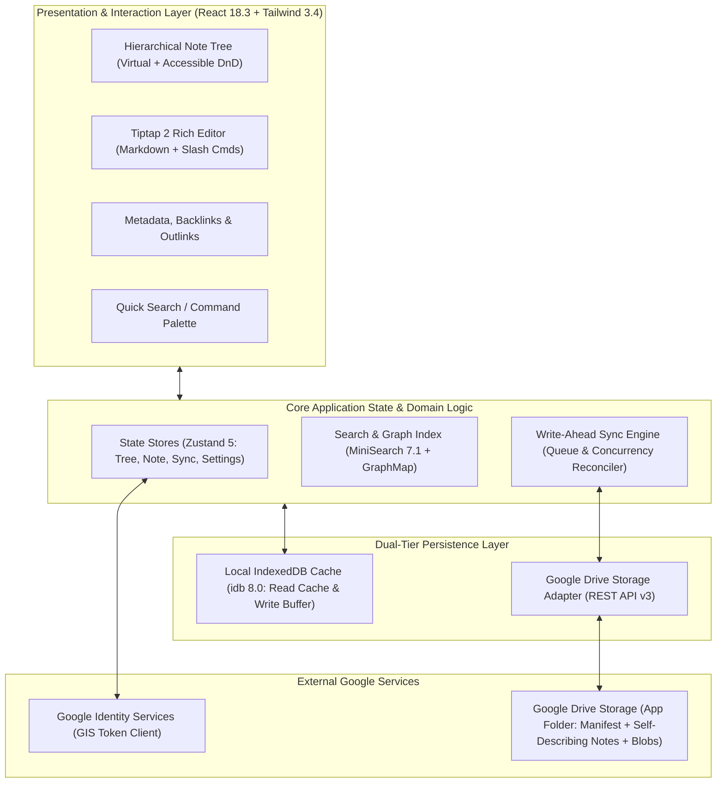

# Architecture Specification

## 1. Executive Summary

This document specifies the system architecture for **Kurippu**, a production-grade personal knowledge management (PKM) application inspired by the desktop-first workflow, hierarchical note tree, and attribute system of TriliumNext Notes.

Unlike Trilium's traditional local SQLite architecture, Kurippu is designed as an **offline-first Single Page Application (SPA)** that utilizes the user's personal **Google Drive** as its authoritative cloud persistence layer.



---

## 2. Technology Stack & Exact Dependency Versions

To prevent version churn and build incompatibilities, exact foundational versions have been evaluated and locked:

| Package | Locked Version | Role & Selection Rationale |
| :--- | :--- | :--- |
| **react** | `18.3.1` | Stable, maximum library compatibility with ProseMirror/Tiptap and headless UI components. |
| **react-dom** | `18.3.1` | DOM renderer for React 18.3. |
| **typescript** | `5.6.3` | Strict type checking, modern ECMAScript decorators, and type definitions. |
| **vite** | `5.4.11` | Blazing-fast development server and optimized Rollup production bundler. |
| **tailwindcss** | `3.4.14` | High-performance utility CSS engine with seamless CSS variable theming. |
| **@tiptap/core** | `2.10.3` | Modular, headless rich-text editing engine based on ProseMirror (MIT). |
| **@tiptap/react** | `2.10.3` | React component wrappers and NodeView bindings for Tiptap (MIT). |
| **@tiptap/starter-kit** | `2.10.3` | Essential extensions: Paragraph, Heading, Bold, Italic, BulletList, History (MIT). |
| **@tiptap/extension-table** | `2.10.3` | Native table nodes, column/row manipulation (MIT). |
| **@tiptap/extension-task-list** | `2.10.3` | Interactive checkboxes / task lists (MIT). |
| **@tiptap/extension-code-block-lowlight** | `2.10.3` | Syntax highlighting for code blocks via `lowlight` (MIT). |
| **zustand** | `5.0.1` | Ultra-lightweight (~1KB) state management, works outside React render trees (MIT). |
| **idb** | `8.0.0` | Promise-based, robust IndexedDB wrapper for local caching and write buffers (MIT). |
| **minisearch** | `7.1.1` | Fast, in-memory, zero-dependency full-text and fuzzy search engine (MIT). |
| **lucide-react** | `0.454.0` | High-quality, consistent SVG desktop iconography (ISC). |
| **dompurify** | `3.1.7` | XSS sanitization for clipboard and user-rendered HTML (MPL-2.0 / Apache-2.0). |
| **nanoid** | `5.0.8` | Cryptographically secure 21-character URL-friendly unique IDs (MIT). |
| **jszip** | `3.10.1` | Client-side ZIP compilation for complete offline backups and restores (MIT). |

---

## 3. High-Level Modular Decomposition

```
src/
├── app/                  # Application bootstrap, routing, global providers
├── assets/               # Branding, SVGs, static assets
├── components/           # Reusable UI primitives (Button, Modal, Dropdown, Tooltip, SplitPane)
├── features/
│   ├── auth/             # Google Sign-In, GIS token manager, session lifecycle
│   ├── note-tree/        # Tree view, drag-and-drop reordering, branch models
│   ├── editor/           # Tiptap setup, slash commands, custom nodes (Callouts, Tables, Code)
│   ├── note-info/        # Right drawer (Backlinks, Outlinks, Labels, Attributes)
│   ├── search/           # Quick search palette, full-text search, filter parser
│   ├── sync/             # Sync queue, change tracker, conflict resolution UI
│   ├── settings/         # User preferences, themes, Drive storage diagnostics
│   └── import-export/    # Markdown/JSON export, ZIP backup, file attachment handler
├── lib/
│   ├── storage/          # Storage abstraction interfaces (IStorageAdapter)
│   ├── google-drive/     # Drive API v3 client, appProperties discovery, batch requests
│   ├── indexeddb/        # IndexedDB schemas, write-ahead buffer, read cache
│   └── search-index/     # MiniSearch document indexer and query builder
├── types/                # Core domain types (Note, Branch, Attribute, Manifest, SyncStatus)
└── styles/               # Global CSS, theme variables, typography
```

### Module Responsibilities:
1. **Presentation Layer (`features/*`)**:
   - Strictly consumes custom hooks and Zustand stores.
   - Zero direct references to Google Drive REST API endpoints or fetch calls.
2. **Core Domain Stores (`features/*/store.ts`)**:
   - Manages immediate interactive state (e.g. `activeNoteId`, `expandedFolderIds`).
   - Dispatches mutations to the local IndexedDB write-ahead log and triggers optimistic UI updates.
3. **Storage Abstraction Layer (`lib/storage/`)**:
   - Defines `IStorageAdapter` contract (`getManifest()`, `saveManifest()`, `getNote()`, `saveNote()`, `uploadAttachment()`, `reconcileLibrary()`).
   - UI code depends solely on `IStorageAdapter`, allowing seamless testing via `MockStorageAdapter`.
4. **Write-Ahead Sync Engine (`features/sync/`)**:
   - Manages a FIFO mutation queue in IndexedDB.
   - Performs version checks against Google Drive, manages rate-limiting backoff, and signals conflicts.

---

## 4. State Management, Data Flow & Persistence Lifecycle

```mermaid
sequenceDiagram
    autonumber
    actor User
    participant Editor as Note Editor (Tiptap)
    participant Store as Note Store (Zustand)
    participant Cache as IndexedDB Cache (idb)
    participant Sync as Sync Engine
    participant Drive as Google Drive API v3

    User->>Editor: Types new content
    Editor->>Store: onUpdate (debounced 300ms)
    Store->>Cache: Synchronous commit to notes_store (<5ms)
    Store->>Cache: Queue mutation in sync_queue
    Store->>User: UI displays "Saved locally"
    
    Sync->>Cache: Pull next pending mutation
    Sync->>Drive: Preflight check: GET /files/{id}?fields=version,modifiedTime
    
    alt Remote is Unchanged (Clean Save)
        Sync->>Drive: PATCH /upload/drive/v3/files/{id} (Multipart content update)
        Drive-->>Sync: 200 OK (New version & modifiedTime)
        Sync->>Cache: Mark mutation committed, update local version metadata
        Sync->>Store: Update UI status: "Saved to Google Drive"
    else Remote Diverged (Concurrent Edit Detected)
        Drive-->>Sync: Returns higher version / newer modifiedTime
        Sync->>Drive: GET /files/{id}?alt=media (Download remote content)
        Sync->>Store: Trigger Conflict Resolution Modal
        User->>Store: Chooses resolution (Keep Local, Overwrite Remote, or Save Both)
        Store->>Sync: Re-queue resolved note
    else Network Outage / Auth Expired
        Drive-->>Sync: Network Error / 401 Unauthorized
        Sync->>Store: Update UI: "Offline - Changes safely saved locally"
        Sync->>Sync: Pause queue; resume automatically on reconnect/re-auth
    end
```

### Persistence Guarantees & Known Boundaries:
1. **Never False Claims**: The application will **never** display *"Saved to Google Drive"* until the Google Drive REST API responds with HTTP 200/201.
2. **Crash Resilience**: Because edits commit to local IndexedDB before network dispatch, normal browser crashes, accidental tab closures, or brief network drops will not discard changes stored in the local write-ahead log.
3. **Storage Eviction Protections & Limitations**: The application calls `navigator.storage.persist()` on startup to request browser protection against storage eviction. However, if running in incognito mode or if device storage is depleted, browser IndexedDB storage can still be constrained or evicted by the operating system.
4. **Conflict Preservation**: If remote file divergence is detected, conflicting note edits are preserved as sibling conflict notes rather than silently overwritten.

---

## 5. Deployment Architecture

Kurippu is engineered as a **100% Client-Side Static Application**:
- **Hosting Target**: Cloudflare Pages, Netlify, Vercel, or GitHub Pages.
- **No Node.js Backend Server**: Client interacts directly with Google Identity Services for authentication and Google Drive API for storage.
- **Edge Deployment**: Static assets are cached across global CDNs for instantaneous load times.
- **Content Security Policy (CSP)**:
  - `default-src 'self'`;
  - `script-src 'self' https://accounts.google.com https://apis.google.com`;
  - `connect-src 'self' https://www.googleapis.com https://accounts.google.com`;
  - `img-src 'self' data: blob: https://*.googleusercontent.com https://drive.google.com`;
  - `style-src 'self' 'unsafe-inline'`;
  - `font-src 'self'`;
  - `frame-src https://accounts.google.com`;
  - `object-src 'none'`.
