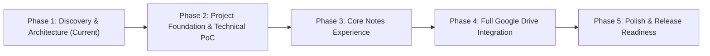

# Comprehensive Implementation Plan & Engineering Roadmap

## 1. Roadmap Overview & Phased Milestones

The project is structured into 5 sequential phases. Critically, **Phase 2 includes an explicit Technical Proof of Concept (PoC)** to validate the Google Drive authorization and concurrency model against live Google APIs before investing in large-scale UI implementation.

---

## 2. Locked Dependency Baseline

To guarantee reproducibility and prevent version drift, exact dependency versions are locked:

| Package | Locked Version | License |
| :--- | :--- | :--- |
| `react` / `react-dom` | `18.3.1` | MIT |
| `typescript` | `5.6.3` | Apache-2.0 |
| `vite` | `5.4.11` | MIT |
| `tailwindcss` | `3.4.14` | MIT |
| `@tiptap/core` / `@tiptap/react` | `2.10.3` | MIT |
| `@tiptap/starter-kit` | `2.10.3` | MIT |
| `@tiptap/extension-table` | `2.10.3` | MIT |
| `@tiptap/extension-task-list` | `2.10.3` | MIT |
| `@tiptap/extension-code-block-lowlight` | `2.10.3` | MIT |
| `zustand` | `5.0.1` | MIT |
| `idb` | `8.0.0` | MIT |
| `minisearch` | `7.1.1` | MIT |
| `lucide-react` | `0.454.0` | ISC |
| `dompurify` | `3.1.7` | MPL-2.0 / Apache-2.0 |
| `nanoid` | `5.0.8` | MIT |
| `jszip` | `3.10.1` | MIT |

---

## 3. Detailed Phase Breakdown

### Phase 1: Discovery, Architecture & Storage Design (Complete & Revised)
* [x] Inspect TriliumNext repository, data models, and documentation.
* [x] Compile detailed Feature Inventory (`docs/FEATURE_INVENTORY.md`).
* [x] Formulate Client-First System Architecture (`docs/ARCHITECTURE.md`).
* [x] Validate Google Drive API v3 capabilities, concurrency, and persistence (`docs/GOOGLE_DRIVE_STORAGE_DESIGN.md`).
* [x] Document GIS Token Model, expiration lifecycle, and manual GCP setup (`docs/SECURITY_AND_OAUTH.md`).
* [x] Complete Clean-Room Licensing Analysis & Dependency Audit (`docs/LICENSING.md`).
* [x] Document Phase 1 Review Findings and Corrections (`docs/PHASE1_REVIEW.md`).

---

### Phase 2: Project Foundation & Technical Proof of Concept (PoC)
**Goal**: Establish a pristine Vite + React + TypeScript repository, configure testing harnesses, and build a verified Technical Proof of Concept validating the Google Drive storage layer before substantial UI development.

- **Milestone 2.1: Foundation Setup**:
  - Initialize clean Git repository in `e:\Kurippu`.
  - Scaffold Vite + React 18.3.1 + TypeScript 5.6.3 project.
  - Setup Tailwind CSS 3.4.14 with PKM desktop theme tokens and dark mode support.
  - Setup Vitest, React Testing Library, ESLint, and Prettier.
  - Verify clean initial build (`npm run build`) and test execution (`npm run test`).
- **Milestone 2.2: Technical Proof of Concept (PoC) Requirements**:
  The PoC must run and pass automated verification demonstrating:
  1. **Google Identity & Drive Authorization**: Initialize GIS Token Client, acquire access token with `drive.file` scope, and verify user profile rendering.
  2. **Application Folder Discovery via `appProperties`**: Query Drive for folder tagged with `kurippuRole='root'`; create folder hierarchy if missing; verify rediscovery across reloads.
  3. **Self-Describing Note Persistence**: Create, read, and update a test note JSON file containing document AST and self-describing branch placement.
  4. **IndexedDB Write-Ahead Persistence**: Commit updates to local `idb` store instantly (<5ms) before initiating Drive network calls.
  5. **Network Interruption & Resumption**: Simulate network failure midway through saving; verify that local note remains intact and sync queue resumes and completes when network returns.
  6. **Concurrency & Conflict Detection**: Simulate two clients editing the same note with different base versions; verify that divergence is detected and conflict resolution hook is triggered without data loss.
  7. **Clean Build & Tests**: Automated test suite covering the storage adapter and sync queue with 100% pass rate.

---

### Phase 3: Core Notes Experience (Local & Offline First)
**Goal**: Build the full desktop knowledge management interface with note tree navigation, Tiptap rich editing, slash commands, tags, and local caching.

- **Milestone 3.1: Desktop Layout & Windowing**:
  - Implement collapsible Left Action Rail (Tree, Search, Favorites, Recent, Settings).
  - Implement Resizable Sidebar with Note Tree.
  - Implement Center Editor Canvas with Breadcrumbs and Save Status Indicator.
  - Implement Collapsible Right Sidebar (Note Info, Attributes/Tags, Backlinks).
  - Implement Responsive Off-Canvas Drawer for mobile (< 768px).
- **Milestone 3.2: Hierarchical Note Tree**:
  - Render recursive nested tree supporting arbitrary depth.
  - Implement node operations: Create Child Note, Rename, Delete (Move to Trash), Duplicate.
  - Implement Drag-and-Drop tree reordering with sibling position calculations.
  - Add Favorites filter, Recently Visited LRU list, and Trash recovery view.
- **Milestone 3.3: Tiptap Rich-Text Editor & Formatting**:
  - Configure Tiptap with Markdown input shortcuts, Headings (H1–H6), Bold, Italic, Strikethrough, Inline Code.
  - Configure Bullet Lists, Numbered Lists, Task Lists with interactive checkboxes.
  - Implement Code Block with syntax highlighting and copy button.
  - Implement Grid Tables with row/column insertion and controls.
  - Implement Blockquotes and Callout / Admonition blocks (Note, Tip, Warning, Caution).
- **Milestone 3.4: Slash Commands Menu**:
  - Implement floating Slash Command popup triggered by typing `/` on an empty block.
  - Real-time text filtering, ArrowUp/ArrowDown navigation, Enter to insert, Escape to dismiss.
  - Register all standard block types: Headings, Lists, Quotes, Tables, Code Blocks, Dividers, Note Links.
- **Milestone 3.5: Note Linking, Backlinks & Search**:
  - Implement inline note link syntax `[[Note Title]]` or `@` autocompletion.
  - Calculate outgoing links and incoming backlinks dynamically.
  - Implement Quick Search Command Palette (`Ctrl/Cmd+K` or `Ctrl/Cmd+P`) with fuzzy search.
  - Integrate MiniSearch for in-memory full-text search across titles and body contents.

---

### Phase 4: Production Google Drive Integration
**Goal**: Wire the verified Google Drive storage adapter into the UI, manage token expiration gracefully, and provide full backup/restore.

- **Milestone 4.1: Live Drive Connection & Sync Engine**:
  - Wire `GoogleDriveStorageAdapter` into Zustand stores.
  - Implement debounced autosave (1500ms after last keystroke).
  - Render real-time save state: *"Saved locally"*, *"Saving to Drive..."*, *"Saved to Google Drive"*, *"Offline"*.
- **Milestone 4.2: Token Lifecycle & Expired Session Recovery**:
  - Implement silent refresh timer (50 min); handle `interaction_required` gracefully.
  - Provide non-intrusive re-authorization banner; ensure pending edits queue safely in IndexedDB until reconnected.
- **Milestone 4.3: Conflict Resolution UI**:
  - Build visual side-by-side diff modal when remote file versions diverge.
  - Allow user to pick Local, Remote, or Save Both as Sibling Conflict Clones.
- **Milestone 4.4: Export, Import & Attachments**:
  - Support drag-and-drop image and PDF attachments stored in `attachments/`.
  - Full backup: export complete knowledge base as a single `.zip` containing `manifest.json`, Markdown files with YAML frontmatter, and attachments.
  - Import: parse `.zip` or `.md` files to reconstruct note trees.

---

### Phase 5: Polish, Verification & Release Readiness
**Goal**: Final verification, theme polish, comprehensive automated test coverage, and deployment documentation.

- **Milestone 5.1: Themes & Accessibility**:
  - High-contrast light and dark themes.
  - Full keyboard accessibility audit (ARIA attributes, tree roles, focus management).
- **Milestone 5.2: Comprehensive Automated Test Suite**:
  - Tree mutations (reorder, move, DAG branching).
  - Slash command parsing and insertion.
  - Storage adapter with mocked Drive API HTTP responses.
  - Sync queue offline replay and conflict handling verification tests.
- **Milestone 5.3: Production Build & Deployment**:
  - Verify zero TypeScript compiler warnings or errors (`tsc --noEmit`).
  - Production bundle optimization and asset hashing.
  - Author deployment guide for Cloudflare Pages / Vercel / Netlify.
  - Author GCP OAuth Client setup instructions in `README.md`.

---

## 4. Technical Risk Matrix & Validated Mitigations

| Identified Risk | Severity | Probability | Validated Mitigation Strategy |
| :--- | :--- | :--- | :--- |
| **Drive API v3 Lack of HTTP `If-Match` ETags** | High | High | Preflight file `version` and `modifiedTime` checks; self-describing note files; 3-way manifest dictionary merge; visual conflict resolution modal. |
| **Google Drive Rate Limits (429)** | High | Medium | Debounced saves (1.5s), manifest-first lightweight metadata, batching, exponential backoff with jitter. |
| **Client-Side Token Expiry (1 hour)** | Medium | High | Silent token renewal at 50 min; fallback to visible re-authorization banner; safe local buffering in IndexedDB. |
| **Folder Loss via User Rename/Move** | Medium | High | Use private `appProperties` (`kurippuRole='root'`) instead of folder names to discover root and notes. |
| **Manifest Corruption / Deletion** | High | Low | Automated reconciliation scanner rebuilds `manifest.json` from self-describing note JSON files. |
| **Offline Data Loss on Browser Close** | Critical | Low | Synchronous write to local IndexedDB write-ahead log *before* network dispatch. Request persistent storage via `navigator.storage.persist()`. |
| **Accidental Ingestion of AGPL Code** | Critical | Low | Strict Clean-Room protocol: all components written from scratch; locked to MIT/Apache dependencies; zero code copied from TriliumNext. |
