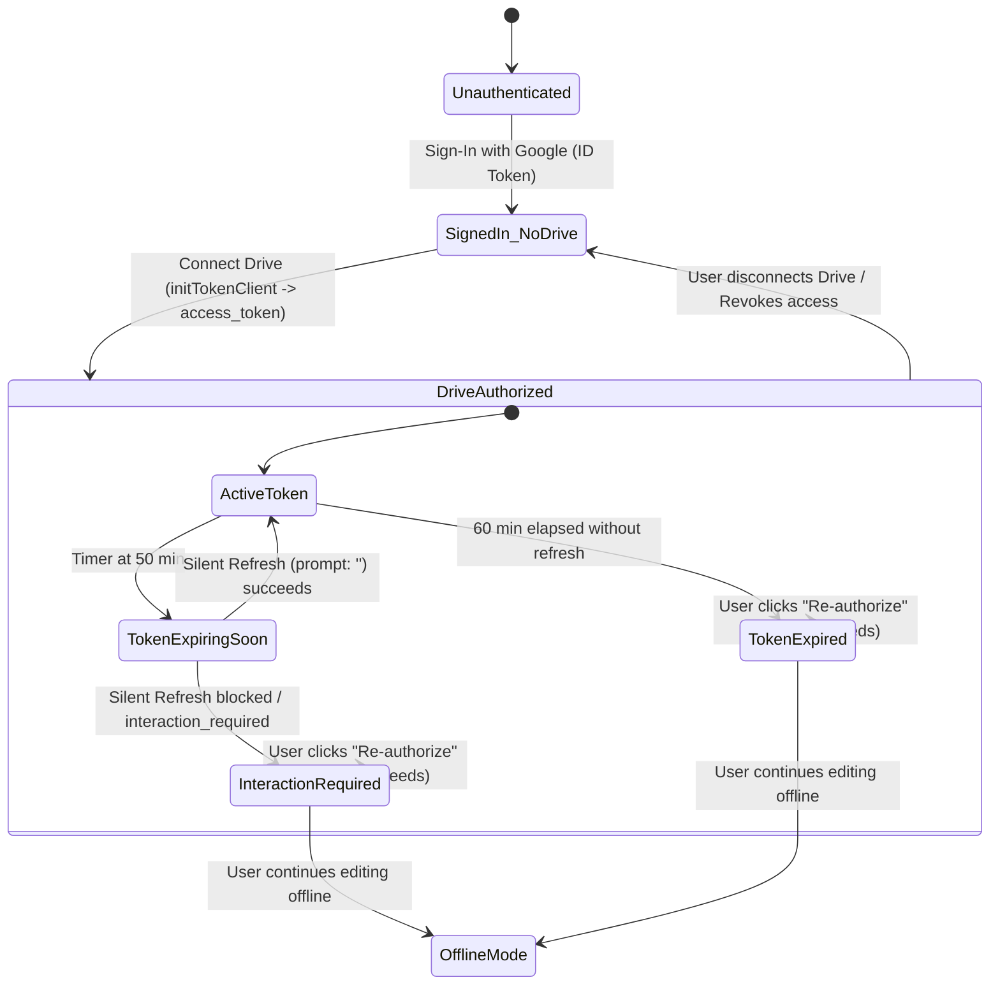

# Security, Authentication & OAuth 2.0 Specification

## 1. Architectural Foundations: Google Identity Services (GIS)

This specification defines the browser authorization and security architecture for **Kurippu**.

In a pure client-side Single Page Application (SPA) without a trusted backend server, Google's current identity platform mandates a strict separation between **User Authentication** (proving who the user is) and **API Authorization** (granting permission to access Google Drive API resources).

```mermaid
flowchart TD
    subgraph Browser_App ["Kurippu SPA (Browser)"]
        GIS_Auth["Google Sign-In (Authentication)\ngoogle.accounts.id"]
        GIS_Token["GIS Token Client (Authorization)\ngoogle.accounts.oauth2.initTokenClient"]
        TokenStore["In-Memory Token Cache\n(Short-lived, non-persisted)"]
        LocalDB["IndexedDB Local Storage\n(Encrypted/isolated per origin)"]
    end

    subgraph Google_Identity ["Google Identity Platform"]
        G_AuthServer["Google Authentication Server"]
        G_OAuthServer["Google OAuth 2.0 Token Server"]
    end

    subgraph Google_APIs ["Google Drive REST API v3"]
        DriveAPI["https://www.googleapis.com/drive/v3"]
    end

    GIS_Auth <--> |Sign-in with Google / Credential JWT| G_AuthServer
    GIS_Token <--> |Request Access Token (drive.file)| G_OAuthServer
    GIS_Token --> |Yields access_token (3600s)| TokenStore
    TokenStore --> |Bearer Authorization Header| DriveAPI
    LocalDB -.-> |Persists offline edits independently| Browser_App
```

---

## 2. Separation of Authentication vs. Authorization

Kurippu explicitly decouples Google account identity from Google Drive storage authorization:

| Dimension | User Authentication (Sign-In) | Resource Authorization (Google Drive) |
| :--- | :--- | :--- |
| **API Mechanism** | `google.accounts.id.initialize` & `renderButton` | `google.accounts.oauth2.initTokenClient` |
| **Artifact Received** | ID Token (JWT containing `sub`, `email`, `name`, `picture`) | Short-lived OAuth 2.0 Access Token (`ya29...`) |
| **Granted Scope** | `openid`, `email`, `profile` | `https://www.googleapis.com/auth/drive.file` |
| **Network Destination** | Client-side verification / User interface display | HTTP `Authorization: Bearer <token>` to Drive API |
| **Persistence** | Decoded user profile cached in `localStorage` for UI | In-memory only; **never** saved to disk or `localStorage` |

---

## 3. Selected Authorization Flow & Limitations

### 3.1 Client-Side Token Model (OAuth 2.0 Implicit via GIS)
Because Kurippu operates as a serverless static web application without a backend server to guard a `client_secret`, it uses the **Google Identity Services Token Client** (`google.accounts.oauth2.initTokenClient`).

### 3.2 Inherent Limitations of Pure Client-Side Authorization
1. **No Refresh Tokens**: Under Google's client-side token model, **no refresh tokens are issued to browser clients**. Refresh tokens require a confidential server exchange (`access_type=offline` with client secret).
2. **Short Access Token Lifespan**: Access tokens issued by GIS expire strictly after **3,600 seconds (1 hour)**.
3. **Silent Refresh Constraints**: While GIS supports requesting a new token using `tokenClient.requestAccessToken({ prompt: '' })`, this silent renewal relies on an active Google session and third-party cookies or session storage in an iframe. Modern browser privacy features (Apple Safari ITP, Firefox ETP, Chrome Privacy Sandbox, third-party cookie blocking, ad-blocking extensions) can block silent renewal, yielding an `interaction_required` or `popup_closed` error.
4. **Indefinite Silent Refresh is Impossible**: Applications cannot assume that silent background token acquisition will run forever without user interaction.

### 3.3 Authorization Lifecycle State Machine & Expiry Handling



### 3.4 Recovery Protocol When Authorization is Unavailable
When authorization expires, is revoked, or fails due to network outage:
1. **Zero Data Loss Guarantee**: All editing operations immediately bypass cloud dispatch and commit directly to the local IndexedDB write-ahead log.
2. **Clear UI Save Status**: The status indicator changes from *"Saved to Google Drive"* to *"Local Only (Drive Re-authorization Required)"* or *"Offline"*.
3. **Non-Intrusive Recovery Banner**: A persistent banner informs the user:
   > *"Your Google Drive authorization has expired. Your notes are safely preserved locally on this device. [Click here to re-authorize Google Drive]."*
4. **Resumption of Sync**: When the user re-authorizes via the interactive GIS popup, the new access token is stored in memory, and the sync engine automatically flushes all pending IndexedDB mutations to Google Drive.

---

## 4. Google Cloud Console Configuration Guide

### 4.1 Step-by-Step GCP Setup

1. **Create Project**:
   - Go to [Google Cloud Console](https://console.cloud.google.com/).
   - Create a project: `Kurippu Personal Notes`.
2. **Enable Google Drive API**:
   - Navigate to **APIs & Services > Library**.
   - Search for `Google Drive API` and click **Enable**.
3. **Configure OAuth Consent Screen**:
   - Select **User Type: External**.
   - **App Name**: `Kurippu`.
   - **User Support Email**: Developer/User email.
   - **Developer Contact Information**: Developer/User email.
   - **Scopes**: Add:
     - `openid`
     - `https://www.googleapis.com/auth/userinfo.email`
     - `https://www.googleapis.com/auth/userinfo.profile`
     - `https://www.googleapis.com/auth/drive.file`
   - **Test Users**: While in "Testing" mode, add the Google accounts that will test the app.
4. **Create OAuth 2.0 Client ID**:
   - Go to **APIs & Services > Credentials > Create Credentials > OAuth client ID**.
   - **Application Type**: `Web application`.
   - **Name**: `Kurippu SPA Client`.
   - **Authorized JavaScript origins**:
     - `http://localhost:5173` (Vite dev)
     - `http://localhost:4173` (Vite preview)
     - `https://<your-subdomain>.pages.dev` (Production edge CDN)
   - *Note*: Authorized redirect URIs are not required for GIS Token Client (`initTokenClient` uses cross-origin postMessage).
5. **No Client Secret Committed**:
   - Copy the generated `VITE_GOOGLE_CLIENT_ID`.
   - Store it in `.env.local` (never committed to Git).

---

## 5. Principle of Least Privilege: `drive.file`

Kurippu strictly uses `https://www.googleapis.com/auth/drive.file`.

### Boundaries of `drive.file`:
- **What it CAN access**:
  - Files and folders created by Kurippu (under the same GCP OAuth Client ID).
  - Files explicitly selected or opened by the user via the official Google Drive Picker dialog.
- **What it CANNOT access**:
  - Any files or folders created by other applications, user spreadsheets, Gmail attachments, or existing Drive documents.
- **Cross-Session and Cross-Device Discovery**:
  - Files created by Kurippu on Device A using Client ID `X` **are accessible** by Kurippu on Device B when logging into the same Google account with Client ID `X`.
  - App metadata attached via `appProperties` is fully queryable across devices under this scope.

---

## 6. Token Security & Content Sanitization

1. **In-Memory Storage**:
   - The OAuth 2.0 access token is held strictly in volatile JavaScript heap memory (Zustand Auth Store).
   - It is never written to `localStorage`, `sessionStorage`, or cookies.
2. **Revocation & Teardown**:
   - When the user signs out, `google.accounts.oauth2.revoke(token)` is invoked to invalidate the token on Google's servers.
   - Local in-memory references are nulled immediately.
3. **User-Generated Content Sanitization**:
   - Pasted HTML is sanitized with `DOMPurify` before AST conversion in Tiptap.
   - Links are restricted to `http:`, `https:`, `mailto:`, and internal `note:` protocols.
4. **Content Security Policy (CSP)**:
   - Configured via static hosting headers to prevent unauthorized script execution:
   ```http
   Content-Security-Policy: default-src 'self'; script-src 'self' https://accounts.google.com https://apis.google.com; connect-src 'self' https://www.googleapis.com https://accounts.google.com; img-src 'self' data: blob: https://*.googleusercontent.com https://drive.google.com; style-src 'self' 'unsafe-inline'; font-src 'self'; frame-src https://accounts.google.com; object-src 'none';
   ```
